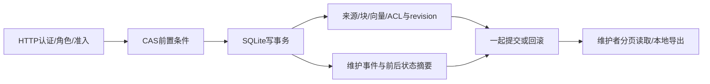

# 0.8：资料维护与审计证据同事务提交

## 背景与业务问题

安全分析员需要知道“谁替换了资料、依据哪个版本授权、为何某个读者失去访问权限”。已有来源ETag/ACL能够阻止旧草稿和未授权读取，但查询trace只记录问答计数，不是维护历史；源文件删除后，当前库也不能解释此前的授权变化。写完业务数据再单独写日志，可能产生“数据已变、证据丢失”的窗口。

本轮在原SQLite资料库加入**已提交维护变更记录**：新增来源、实际替换、实际删除、读ACL实际替换。业务数据、块/向量、ACL、修订和事件在同一个`BEGIN IMMEDIATE`事务提交；事件写失败则一起回滚。没有新增模型调用、外部日志平台或后台任务。

这不是完整安全审计系统：不记录认证失败、拒绝、412、解析失败、查询/解析请求及no-op；没有历史全文恢复、人工审批、IdP、签名/WORM或防数据库管理员篡改能力。仍只支持可信本机、单worker回环部署。

## 设计与数据边界



资产包括当前资料、ACL、操作归属、历史状态摘要和导出的管理元数据。HTTP调用者→服务端身份、业务事务→事件、私有库→导出文件是三个主要边界。

| 字段 | 含义及限制 |
| --- | --- |
| seq | 库内AUTOINCREMENT序号，按提交写入顺序读取；不承诺连续无空洞，不是跨库全局ID |
| revision | 与本次真实资料/ACL变更对应，唯一；不是查询trace ID |
| at_utc | 服务端UTC墙钟观察值，毫秒格式；时钟可回拨，排序以seq为准 |
| actor_kind / actor_id | API由已认证lease里的maintainer身份注入；本地库/CLI默认local/null，不伪装成已登录用户 |
| action / source | 四类实际变更及来源逻辑标签；source没有级联外键，删除来源后事件仍保留 |
| before_state / after_state | 来源ETag、正文/配置摘要、来源generation、ACL ETag/generation及读者ID列表；新增前/删除后为null |

事件不复制正文、问题、提示词、原始令牌、凭据摘要或向量。**来源标签、读者ID及历史授权关系仍可能敏感**，只对维护者开放，本地库/备份/导出按私有资料保管；没有自动脱敏。ETag和SHA256仅绑定状态，不是签名或认证证据。

API请求模型禁止额外actor字段，`X-Actor-ID`等客户端头不决定归属。当前身份仍是静态令牌配置的逻辑ID：重配/重用ID不证明同一个自然人，没有IdP身份连续性；可信本地Python调用者能自行构建AuditActor，不能据此认证人类身份。正文/配置实际替换清空读者，其前后列表也进入同事务证据；凭据轮换可能保持读者ID但改变ACL ETag，不公开绑定摘要。

## 事务语义与失败处理

1. 保留原create-only/If-Match检查和授权CAS；解析/向量计算仍在提交事务前。
2. 在写事务里复核当前ETag，读取旧状态，再做资料/ACL及修订修改。
3. 在同一连接写事件；只有连接上下文成功提交，变更与事件才一起生效。
4. 数据或事件写入/提交失败时回滚。仅已提交变更有事件；失败尝试不产生“成功记录”。

no-op不改revision、不制造变更事件。相同旧标签并发修改，只有真正提交的胜者写事件。响应发送失败则不能反向撤销已提交事务：此时资料与事件可能已经存在，即使客户端看到断线/错误。客户端需重新读取来源和审计证据再判断，不能自动刷新ETag覆盖或把一次网络错误解释为未提交。该事件账本没有提供请求幂等键/任务恢复。

为限制原型存储，每库最多**10,000条事件**。达到上限后，新的实际变更返回HTTP503 `audit_capacity_exhausted`，CLI维护退出5，事务回滚；读/导出和no-op仍可用。检查与写入在同一写锁内，不能并发超发。没有自动删除、静默丢日志或环形覆盖。解析/嵌入可能已发生，这不是全请求计算预算；授权维护者仍可能把库写满。

**上限处理**：停止全部写者，用SQLite备份机制保存私有完整库；导出固定快照并核验成功/事件数，保留原库及导出。当前没有自动归档清理/清空接口，导出本身不会解除写入阻塞。如果需要继续工作，须管理员计划新库、从合法原始资料重建并重新审阅授权，明确新instance/ETag及历史边界，旧库保留只读。不要为了继续写入直接DELETE事件或修改schema；这会破坏记录范围的可信假设。长期生产使用仍需要正式保留/归档流程，这一版本不替代它。

## API分页与本地导出

`POST /v1/audit/events`只允许maintainer；缺认证401、reader/analyst403，继续受到正文前准入和`Cache-Control: no-store`保护。首次请求：

```json
{"limit": 50}
```

响应包含`events`、`snapshot`和`next_cursor`；snapshot包含库instance、首个页面观察的`through_seq`及`audit_start_revision`。后续请求使用服务端返回的完整游标：

```json
{"limit": 50, "cursor": {"instance_id": "aaaaaaaaaaaaaaaaaaaaaaaaaaaaaaaa", "after_seq": 50, "through_seq": 120}}
```

以上游标只是格式示例，应使用自己响应中的值。每页1..100条，布尔/字符串数字及多余字段422；错误库instance或超出当前记录范围409，客户端应从第一页重新开始。后续页只读`seq <= through_seq`，导出期间新提交不混入旧快照，下一轮新导出可见；不跨HTTP请求长期占数据库事务/内存快照。

游标是定位信息，不是权限凭证或签名。客户端可以自选跳过区间，不能将任意拼出的游标导出称为完整证据；数据库管理员可修改旧记录，快照也不能抵抗这种行为。服务端不提供公开下载URL，不把actor/token放查询参数。

安装基础依赖并按[角色启动指南](ACCESS_CONTROL.md)运行本地API，客户端环境变量`RAG_API_TOKEN`加载自己的维护令牌，然后：

```bash
python -X utf8 -m compliance_rag.audit_export --out output/maintenance-export-new.json
```

默认连接`http://127.0.0.1:8000`，可用`--url http://127.0.0.1:其他端口`；只接受该回环HTTP origin，拒绝URL凭据/路径/查询、重定向和代理环境。令牌仅从本地客户端环境读取，不打印，不在聊天中发送。

导出器按50条遍历固定快照，检查稳定snapshot、序号递增/边界、游标推进及终页上界；每响应512KiB预算、最多200页。它不认证远端执行或数据库真实性，也不为每个事件提供密码学完整性证明。网络read timeout不是导出全程硬时限。

所有页面成功后才独占、原子创建输出；错误退出2，不回显token、正文、路径或原始异常，不覆盖已有文件。成功退出0仅打印事件数量。文件保留完整管理元数据并受`output/`忽略规则保护，**忽略规则不是访问控制**；不要提交真实导出到公开仓库。

## schema4升级与兼容性

升级前停止所有旧API/CLI/脚本写者并私有备份，在副本验证。首次用0.8正确模型配置打开schema1/2/3库，沿原迁移链在同一个事务创建事件表、写入`audit_start_revision=当前revision`、置schema4；原资料、块/向量、来源及ACL ETag、ACL、revision和instance不因3→4迁移改变。

旧历史**不回填虚构操作者/时间**。审计页明确给出记录边界：例如start_revision=9，首次后续真实变更revision=10才有事件。迁移故障回滚表/边界/schema标记；已是schema4却缺失事件表时资料库初始化失败，不自动建空表掩盖历史丢失。本轮未迁移用户工作区的私有库，只验证临时独立夹具。

旧版本新打开schema4会拒绝，但已初始化的旧写者或直接SQL仍可能绕过新逻辑，必须全部停止；schema标记不是对恶意/旧写者的数据库权限控制。回退用升级前备份和对应旧程序，不把schema数字手改回3。底层事务依据见[SQLite事务](https://www.sqlite.org/lang_transaction.html)，序号边界见[SQLite AUTOINCREMENT](https://www.sqlite.org/autoinc.html)；本项目不将其推导为硬件掉电、跨库或WORM保证。

## 复现与实际边界

```bash
python -X utf8 -m compliance_rag.audit_demo
python -X utf8 -m compliance_rag.live_smoke
python -X utf8 -m pytest tests/test_audit.py -q
```

[固定实验](../examples/evaluation/maintenance-audit.json)运行真实SQLite与进程内ASGI：新增→授权→替换清空1项授权→删除后重启保留4事件；读端401/403/200，陈旧标签412、no-op无事件；真实SQLite trigger注入审计插入故障返回503，来源/修订/事件保持原状，解除故障后成功提交。第一页后新提交不进入原两事件快照。固定报告只含合成汇总，无运行时凭据/随机ETag/私有路径。

live_smoke另启真实Uvicorn回环HTTP，并让导出器实际HTTP读取删除后4事件及服务端actor。评分/原始协议替身/真实BGE/真实LLM是不同证据：本轮不调用LLM，也不声称修复18题中6个不充分返回。0.7的原始报告保留，只在回归比较时核对当前版本并归一化target版本号，其余逐题/指标/目标模式与embedding检查不放松。

专项回归还覆盖同事务前后故障、SQL序列回滚、并发CAS/事件容量、独立schema3迁移和回滚/并发打开、伪造actor、52事件真实ASGI跨页导出、坏响应/重复序号/换快照/停滞游标/超限页，以及提交后响应发送失败。它们是原创合成实验，不是企业审计部署或第三方安全认证。
