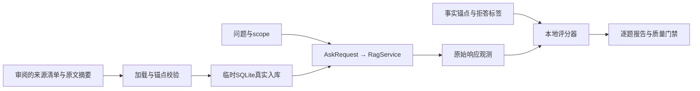

# 事实覆盖与拒答评测：引用真的存在，问题就回答对了吗？

## 1. 背景与本轮范围

0.2—0.6已经有检索、原文引用、来源授权和生成预算，但原20问开发报告主要检查命中和引用位置。对于“进入记录用什么加密算法”，返回一段真实的留存制度，也能通过原文切片检查。这是**引用真实性与回答充分性被混淆**的工程风险，不能靠再加一个成功聊天截图来证明解决。

0.7新增可离线运行、可重放、可逐题比较的质量工具，沿用原仓库的真实SQLite/RAG路径。没有修改在线检索阈值、生成提示词或拒答策略，没有把测试集答案装进运行时。最终交付是**可核验的质量诊断与门禁**；当前抽取基线仍未通过该质量门禁。

本套采用面向后续“完整回答问题”的严格验收合同；当前在线`status=evidence`只承诺提供原文证据，并不保证已经回答完整问题。因此“负例返回不充分原文”不能直接说成系统编造了算法、声称通过测评或发生了安全入侵。

工具不依赖评判LLM、LangSmith账号或云端上传。评测维度参考[LangChain官方RAG评测说明](https://www.langchain.com/langsmith/evaluation)对检索与生成质量的区分；本实现是本地自定义的原文选摘合同检查，不声称实现其通用语义评判器。

## 2. 数据与可信边界

`examples/quality/`包含4份新写的虚构北辰手册、18个问题：10个有答案、8个应拒答。覆盖v1/v2、二级/三级、物理/网络安全类，包含3个多事实问题、相同问句不同scope、相关但缺事实、部分有依据及要求测评结论的负例。所有数字和制度都是原创合成练习，**不是国家标准**。

`suite.json`独立列出来源名、规范化原文SHA256、来源完整scope、逐题预期、必要事实及`any_of`原文锚点、标注理由。每项事实至少一个可接受锚点；同题全部事实均需覆盖。加载时验证锚点唯一存在、来源在范围内、正负例齐全、ID唯一；拒绝跨scope或悬空锚点、文件名越界、重复JSON键和超限输入。读取的文件和CLI输出目录由可信本机开发者管理，不是公共上传接口或恶意本机文件系统沙箱。

**标注由AI辅助原创，未经过独立人工复核。** 虽与旧20问/12块开发数据分开，也未用于本轮阈值或提示词调优，但公开可见且作者/实现者并不独立，不能称第三方评测、盲测或生产留出集。后续在此集上调试后，它应继续作为回归集，另收集获许可的人工审阅测试集。



`capture`只把新建的`AskRequest`交给目标，不传case ID、expect、facts或rationale；scope也深拷贝。`RagService`和生成器不读取评测标注。这个调用边界防止正常接线时答案泄漏，**不能阻止恶意目标直接读取本机gold文件**。CLI跑的是可信本机、`identity=None`的资料库路径，不评价HTTP鉴权/ACL效果，已有来源权限回归单独验证那些能力。

## 3. 评分逻辑与分母

| 检查 | 计算方式 | 能证明什么 |
| --- | --- | --- |
| 原文/范围 | 从审阅清单确定文件scope和SHA256，再验证响应元数据；按规范化文本重放字符半开区间与行号 | 引用与所声明的这份本地资料一致，且适用于指定scope |
| 引用来源链 | citation ID、块ID/元数据、source ETag与本次有效hit一致，引用区间包含于该hit | 引用属于该份响应的检索证据；不证明响应来自真实远程模型 |
| 全事实检索率 | 10个正例中，所有必要锚点都被有效hit覆盖的比例 | 检索是否提供了全部标注事实，区别于任意一个gold命中 |
| 完整事实回答率 | 10个正例中，全部必要锚点被有效引用覆盖，且答案符合原文选摘渲染合同的比例 | 在这份标注下，原文选摘是否充分；不是开放式语义正确率 |
| 无答案语义拒答率 | 8个负例中，status=refused、答案/引用空，且原因为no_evidence或model_abstained的比例 | 排除操作故障后的可接受拒答行为；该名称不表示证明了模型语义推理能力 |
| 操作性拒答 | 未配置模型、超时、上游错误、知识变化等拒答单列计数 | 这些情况不会被算成“成功识别无答案” |
| 原文不充分返回 | 负例仍返回evidence的数量 | 可能返回相关原文，但不满足本题完整回答合同；不是在统计编造文本 |

空引用显示`not_applicable`，不使用空集合`all()`制造“100%引用有效”。有答案题只拒答不能过门禁，全部拒答会使10个正例全失败。取到全文却只引用一半事实也会失败；在有效原文外额外拼“所以通过测评”的自由文本会违反答案合同。

一个事实的锚点必须完整落在一个有效hit/引用中；不把跨段碎字符拼接当成证据。多事实允许来自多个引用和安全类，但仍必须在请求范围内。当前不评价额外引用的噪声比例，不推断表格语义、否定、因果或开放式改写蕴含；错误gold同样会导致错误评价，需人工审阅。

SHA256把来源规范化字节、清单、问题、scope和标注绑定为套件指纹。BOM/CRLF规范化保持与入库一致，**字符坐标是Python Unicode字符偏移，不是UTF-8字节偏移**。source ETag随临时库实例变化，评分只检查格式及响应内一致性，不把它当可独立验证的签名。报告也不证明ACL、来源权威性或远程调用真实性。

## 4. 运行、重放和逐题比较

从仓库checkout根目录、基础依赖环境运行，使用全新的输出文件名：

```bash
python -X utf8 -m compliance_rag.quality_eval run --responses output/baseline-responses.json --out output/baseline-quality.json --gate
python -X utf8 -m compliance_rag.quality_eval score --responses output/baseline-responses.json --out output/replayed-quality.json --gate
```

当前两条命令均应退出 **3**，同时写出报告，表示质量不通过；不是程序崩溃。去掉`--gate`退出0仅代表报告成功生成。输入/配置/IO错误退出2，既有文件不覆盖，输出不得覆盖套件、来源或待重放观测。不存在`--force`或忽略失败开关；换输出文件名保留证据。

每个输出独占创建、文件级原子发布；两个输出不是同一个事务，第二个IO失败时第一个可能已经存在，应检查退出码并保留已有证据。

观测包含原文、问题处理结果、trace等，仅写入被忽略的`output/`并按资料敏感级别保管。默认只打印报告；报告只包含案例ID、事实ID、静态诊断、指标及严格限制的目标声明，不打印问题、正文、答案、provider异常或trace ID。报告默认也不自动推送GitHub。

修改目标后再采集候选，然后逐题对比：

```bash
python -X utf8 -m compliance_rag.quality_eval run --responses output/candidate-responses.json --out output/candidate-quality.json
python -X utf8 -m compliance_rag.quality_eval compare --baseline output/baseline-responses.json --responses output/candidate-responses.json --out output/paired-quality.json --gate
```

比较器重新评分两份**原始观测**，拒绝把汇总报告当输入；套件指纹或case清单不一致直接退出2。输出改进/退化案例ID及各指标差值。当前门禁要求候选所有正负例通过，且无逐题退化；不会用总分改善掩盖某个安全负例退化，也不接受删掉失败题再比。

套件可用`--suite path/to/suite.json`显式传入；开发工具当前默认数据随源码checkout提供，独立wheel使用者须自行提供获许可的套件目录。最多16文件、128题；每份原文1MiB、清单256KiB、重放观测16MiB、每响应128KiB、每次最多5个hit/引用。

### 可选真实BGE与生成服务

`--retrieval dense|hybrid --model-path 已准备的本地目录`走现有真实BGE路径，不下载权重，记录具体embedding identity。安装/准备步骤见[RAG运行指南](RAG_GUIDE.md)。默认`extractive`即使进程已有外部环境变量也不读取生成配置、不出站调用模型。

仅显式选择`--generation llm`时才读取已获许可的服务端配置并走0.6监督worker；未配置则退出2，不生成一份“模型未配置所以全拒答成功”的报告。它仍只向服务发送合成问题和候选原文，不传gold。兼容协议结果与真实LLM质量必须由实际调用证据区分，`target`是声明而非远程执行证明。没有新增云端评判服务或自动使用付费API。

## 5. 已观测结果与CI含义

[BM25完整逐题报告](../examples/evaluation/quote-quality.json)：全事实检索10/10、完整事实引用回答10/10；无答案仅拒2/8，6题仍返回相关但不充分原文。6题的原文引用检查均有效，恰好证明“引用存在”不能替代“能回答”。本轮没有对这些失败做关键词特判或使用gold替换响应。

真实本地512维BGE在禁止socket connect/DNS的环境下也运行了18题：[Dense报告](../examples/evaluation/quote-quality-dense.json)、[Hybrid报告](../examples/evaluation/quote-quality-hybrid.json)，两者同为10/10、10/10、2/8及6题失败。报告记录实际权重/分词器摘要绑定的embedding identity。生成仍为extractive，不是LLM；本轮没有证明Dense/Hybrid比BM25更好。基础CI不下载这些权重，真实BGE记录来自本机可选依赖环境。

质量门禁明确`passed=false`。CI的测试与独立诊断步骤验证该结果可复现，并要求`--gate`实际返回3且报告与已审阅fixture一致。**绿色Tests仅代表实现/回归可复现，不代表质量门禁已通过或可以生产发布。** 实际改善或退化应先审阅逐题证据，再更新fixture，不允许只把期望失败改成成功。

旧20问题库的3/4拒答与本套2/8来自不同问题和分母，不能写成同数据效果下降或提升。固定报告不记录耗时/随机ETag，避免把小样本运行速度包装成性能指标。

## 6. 风险、方案与下一步

资产包括原始资料、参考答案、评测观测与质量结论。主要信任边界是目标响应→评分器、来源/标注→可信清单、私有观测→公开报告。响应元数据不能覆盖来源清单；空引用/操作失败不计质量成功；报告不回显正文；输入/输出有界且不可覆盖既有证据。开发者仍可篡改代码、gold或观测，指纹不是认证/防篡改审计。

本轮解决了**测量失真、错误分母、标注接线泄漏和比较丢题**，未解决通用事实蕴含或线上相关但无答案的拒答。下一阶段应先对获许可资料做独立人工复核，明确部分回答的产品合同，再使用独立评判/结构化证据方案与真实生成服务，在未参与调优的资料上验证。不要为了让这18题通过，把题号、gold或“加密算法”等词放进线上拒答规则。
